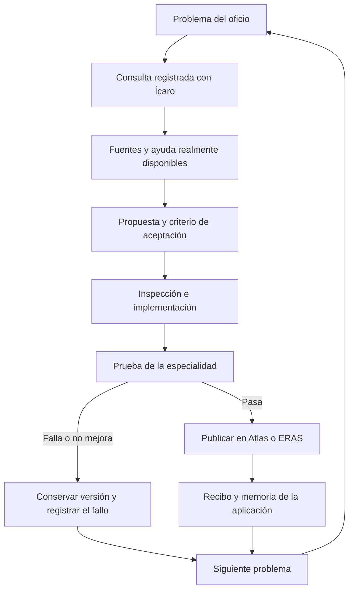

> Actualización funcional del 12-11-2026: consultar [functional-audit.md](functional-audit.md) y lib/collaboration/missions.ts. Hay 107 responsables; los 24 oficios son solo la parte visible de Atlas.

# Atlas y ERAS: análisis del proyecto y del ciclo de evolución

Estado de este análisis: distingue el software publicado de las ampliaciones preparadas en el repositorio. La existencia de código, una propuesta o una tarea programada no demuestra que una mejora esté publicada ni que la tarea se haya ejecutado.

## 1. El objetivo que debe gobernar el proyecto

Atlas es un mundo de oficios que desarrolla capacidades útiles. Cada habitante investiga problemas propios, pide ayuda a Ícaro, propone una intervención, la somete a una prueba apropiada y conserva el resultado. La evolución debe percibirse en lo que se puede hacer y en cómo se utiliza el mundo.

Remodelar el mundo incluye componer y mezclar mejor, construir herramientas, mejorar memoria, editar una secuencia, hacer una interacción más clara o corregir el motor. Una sala con otro color no sustituye una capacidad nueva. Una capacidad útil tampoco necesita terminar siempre en una escultura.

ERAS es el entorno de gráficos e interacción con el que se pueden expresar algunas de esas capacidades. Sus especialistas trabajan en ingeniería 3D, mientras otros habitantes desarrollan sus propios oficios.

## 2. Lo que hay realmente en el código

| Pieza | Responsabilidad observable | Límite actual |
| --- | --- | --- |
| Atlas, aplicación con servidor | Chat, estudios, trabajos, documentos, memoria, propuestas, artefactos y controles | Necesita adaptadores por oficio; generar una escena no cubre todos los dominios |
| ERAS, aplicación estática | Juego, personajes, cámara, gráficos y controles | Tiene su propio repositorio y publicación; sus cambios no llegan automáticamente a Atlas |
| Groq | Inferencia de los modelos autorizados | Disponibilidad y cuota finitas; varios papeles no equivalen a varios modelos |
| D1 | Historial, versiones, consultas, memoria y bloqueos | Persistir información no demuestra que se haya entendido ni aplicado |
| Motor de escenas | Geometría, arquitectura procedural, animaciones y presentaciones | Un programa de escena es una parte acotada del software |
| Laboratorio espacial | Compara distribuciones mediante una métrica reproducible | No evalúa belleza, narrativa o calidad general |
| Tarea de nube | Despierta y ejecuta trabajo sin tener un PC encendido | Necesita acceso de ejecución y publicación; no garantiza servicio continuo sin límites |

La separación entre Atlas y ERAS es una decisión de arquitectura real. Hay piezas de render y controles derivadas de ERAS en Atlas, pero no existe una actualización automática de todas las piezas compartidas. Cada propuesta debe declarar si modifica Atlas, ERAS o una integración entre ambos.

El problema encontrado era concreto: la agenda reciente enviaba a muchos habitantes al mismo constructor 3D y al mismo ajuste de posiciones. Eso preservaba diferencias de nombre y estilo, pero reducía sus acciones a una sola clase de resultado. La ampliación por vocaciones sustituye esa selección por una rotación de los 24 oficios.

## 2.1. Punto de partida alto: aprovechar lo que ya existe

La inspección de ERAS muestra una base bastante más avanzada que la casa actual de Atlas. El repositorio conserva avatares glTF con esqueleto, una biblioteca local de animaciones, simulación de capa, materiales y texturas, cámara con colisiones y rutas WebGPU/WebGL. El README documenta 17 clips y dos cuerpos preparados a partir de recursos con procedencia y licencia conservadas. Es un inventario del repositorio, no una nueva validación visual de esas capacidades en todos los dispositivos.

Atlas representa sus habitantes mediante piezas instanciadas y emplea su propia casa y sus propios contratos de escenas. La diferencia de complejidad procede en parte de esa integración reducida. No conviene atribuirla únicamente a que los modelos o personajes tengan que aprender más.

El límite expresivo de la aplicación importa tanto como la capacidad del modelo. Un profesor experto limitado a ocho objetos y tres instrucciones de movimiento seguirá produciendo intervenciones acotadas. El ejecutor de programación debe poder ampliar los propios módulos y contratos, con pruebas y publicación, en lugar de permanecer para siempre dentro de esos mismos límites.

El arranque avanzado debe seguir este orden: auditar capacidades y licencias existentes; elegir una base funcional; integrar piezas compatibles; comprobar rendimiento y experiencia; y usar la investigación para resolver los problemas restantes. Los modelos ya entrenados aportan propuestas y código desde su conocimiento actual. Atlas conserva las capacidades integradas, las herramientas y la experiencia verificable. Eso no equivale a transferir automáticamente los pesos o toda la inteligencia de otro modelo.

La primera transferencia gráfica debe tratarse como una integración de motor: escala y orientación de avatares, rig/animaciones, presupuesto de render, carga de recursos, controles y compatibilidad. Copiar un modelo al repositorio no demuestra que esté conectado a los trabajos ni que funcione bien en móvil.

## 3. Aprender tiene varios significados que necesitan registros distintos

1. **Adquirir evidencia:** leer un documento con fecha, URL y contenido observado.
2. **Formular una propuesta:** relacionar esa evidencia con un problema del oficio.
3. **Comprobar una intervención:** ejecutar una prueba con entradas, criterio y resultado.
4. **Aplicar una capacidad:** guardar un artefacto utilizable o publicar código que cambia el comportamiento.
5. **Conservar experiencia:** recuperar después lo que funcionó, falló y quedó pendiente.
6. **Entrenar un modelo:** modificar sus pesos mediante un proceso de entrenamiento y evaluación separado.

El repositorio también contiene un laboratorio que genera y ejecuta programas numéricos en un lenguaje de expresiones acotado. Tiene utilidad verificable, pero no permite por sí solo reescribir una aplicación entera. La programación del sistema requiere además el ejecutor de cambios de código y publicación.

El proyecto trabaja principalmente con los cinco primeros niveles. No hay que presentar mejoras de instrucciones, memoria o código como entrenamiento de pesos. Tampoco puede deducirse inteligencia general de un banco pequeño de pruebas.

## 4. La unidad de trabajo debe ser una misión de oficio

Cada misión necesita estos datos:

- Habitante, oficio, problema y motivo por el que merece resolverse.
- Capacidad o conducta actual que se quiere cambiar.
- Fuentes realmente leídas y objeciones todavía abiertas.
- Herramientas y modelos que hayan intervenido de verdad.
- Propuesta concreta, destino y dependencias con otros oficios.
- Criterio de aceptación antes de construir la candidata.
- Artefacto o cambio de código, pruebas ejecutadas y límites de la comprobación.
- Versión anterior, publicación real y recibo con procedencia.
- Una siguiente pregunta derivada del resultado, no una repetición automática del encargo.

Una misión no debe declararse terminada cuando sólo tiene un texto prometedor. El lector de documentos, el proponente, el revisor y el ejecutor son funciones diferentes, aunque compartan infraestructura.

## 5. Distribución de responsabilidades

La matriz completa y las fuentes candidatas están en `domain-evolution.md` y en `lib/collaboration/vocations.ts`.

| Habitante o equipo | Qué debe producir | Cómo comprobarlo |
| --- | --- | --- |
| Lía | Diálogo claro, continuidad, cancelación y contexto autorizado | Casos de conversación, restricciones, recuperación y ausencia de recuerdos inventados |
| Noa | Composiciones, variaciones e instrumentos editables | Intervalos, ritmo, notas, silencios, formato musical y reproducción/exportación cuando esté disponible |
| Ritmo | Mezcla y procesamiento del sonido | Pico, recorte, componente continua, silencio, balance y escucha contextual |
| Vera y Alba | Evidencia y procedencia | Lectura real, referencias, pertinencia, contradicciones y vigencia |
| Nilo | Experimentos reproducibles | Hipótesis que pueda fallar, comparación y conservación de resultados negativos |
| Talo | Ingeniería de gráficos | Misma escena, mismo dispositivo/configuración, geometría, memoria, draw calls y tiempo de cuadro |
| Zuri | Interacción y prototipos | Secuencias de entrada, objetivos, colisiones, cámara, respuesta y reinicio |
| Faro | Encuadres, montaje y secuencias | Guion ejecutable, tiempos, continuidad, controles y exportación compatible |
| Nora | Memoria útil | Recuperación pertinente, procedencia, vigencia, contradicciones y separación entre evidencia e hipótesis |
| Ion y Pico | Herramientas y acciones | Contratos, resultados reproducibles, límites de entrada, idempotencia y reversión |
| Ada y Cota | Evaluación y comparación | Regresiones, casos reservados, criterios estables y alternativas justificadas |
| Sol, Sigma y Ema | Estructura, símbolos y significado | Esquemas, transformaciones, invariantes y tratamiento explícito de ambigüedad |
| Ícaro | Ayuda apropiada a la misión | Disponibilidad, selección por tarea, coste, respuesta recibida y utilidad comprobada |
| Teo | Narrativa | Coherencia y continuidad de una secuencia concreta |
| Luz | Color e iluminación | Gestión de color, contraste y legibilidad en escenas definidas |
| Mara | Crítica sonora | Claridad y niveles dentro de una experiencia reproducible |
| Mico | Movimiento e interacción | Contactos, controles, cámara y legibilidad de la acción |
| Leo | Accesibilidad | Teclado, foco, etiquetas, contraste y preferencias de movimiento |
| Brisa | Ritmo y montaje | Duraciones, transiciones y relación temporal entre imagen y sonido |

Los seis espectadores tienen oficios críticos. Su asignación no prueba trabajo realizado: necesitan entradas observables y un resultado registrado, igual que los demás habitantes.

## 6. El papel de Ícaro y de la constelación

Ícaro coordina el acceso a ayuda. Para una composición debe buscar fuentes y herramientas musicales; para una cámara, ingeniería de interacción; para una memoria, recuperación y evaluación. Un catálogo de agentes de programación no resuelve por sí solo todos esos trabajos.

Los modelos se seleccionan entre los realmente disponibles y evaluados. La calificación existente es pequeña y no acredita quién es el mejor del mercado. Una revisión de otro modelo aporta otra respuesta, pero no sustituye una prueba del cambio.

El viaje es la representación de una consulta real. Los estados de búsqueda, consulta, regreso o bloqueo deben proceder del servidor. No hay que incrementar aprendizaje por caminar, mostrar una pose de trabajo o reproducir un recibo antiguo. La frescura del evento y las colisiones de las rutas se comprueban por separado.

Ícaro y Alba ya están en la constelación: sus propias tareas no requieren inventar un viaje hacia sí mismos.

## 7. El paso que convierte investigación en mejora

El servidor de Atlas puede recopilar fuentes, utilizar sus modelos y guardar propuestas. No dispone de credenciales administrativas de Git o Sites para editar y publicar por su cuenta. Esa parte corresponde al flujo de ingeniería de la tarea de nube: abrir el repositorio adecuado, inspeccionar las fuentes, implementar, probar, subir el commit, publicar y comunicar el recibo.

Por eso son necesarias dos comprobaciones independientes: que la consulta ocurrió y que el cambio está publicado. El endpoint conserva los recibos comunicados por el flujo autenticado; no se presenta como una verificación directa de los metadatos de Sites por el Worker.

El futuro ejecutor debe resolver una misión concreta por vuelta, inspeccionar el estado actual y evitar volver a aplicar un cambio que ya exista. Las fuentes externas se tratan como datos; no autorizan órdenes nuevas ni cambios de permisos.

## 8. Dos aplicaciones piloto para demostrar que no todo acaba en 3D

**Noa: transposición musical.** La candidata desplaza todas las notas del bajo por un número entero de semitonos, conserva sus intervalos, ritmo y mezcla, rechaza desplazamientos fuera del rango permitido y permite deshacer la edición. Las pruebas comprueban notas activas e inactivas, límites e inmutabilidad de la entrada. Escuchar el resultado y comprobar su exportación real requieren el navegador; una prueba numérica no acredita gusto musical.

**Zuri: cámara de ERAS.** Se encontró que un barrido vertical o descendente podía atravesar la parte superior de un obstáculo porque sólo se descartaba o resolvía su huella horizontal. La candidata intersecta los intervalos horizontal y vertical del volumen simplificado. Incluye un caso que fallaba en la base y pasa con el cambio, y conserva otros movimientos permitidos. No equivale a colisión exacta con todas las mallas ni a una revisión visual de la partida.

Estos pilotos tienen artefactos, pruebas y destinos distintos. Su publicación y asociación con consultas deben verificarse mediante recibos reales; que estén preparados en el repositorio no los convierte en cambios publicados.

## 9. Evitar mejoras aparentes

El laboratorio espacial es un ejemplo útil de este riesgo. Aumentar la separación mínima entre envolventes puede reducir solapamientos conservadores, pero también dispersar una instalación cuya intención era formar un núcleo compacto. La cifra mejora y la composición artística podría empeorar.

Cada prueba debe medir la capacidad que importa al oficio y conservar restricciones adicionales. Hacen falta criterios combinados: corrección, utilidad, rendimiento, compatibilidad, accesibilidad e intención del diseño. Las preferencias estéticas requieren evaluación contextual o del usuario; no deben quedar sustituidas por una cifra conveniente.

Otros falsos positivos que deben evitarse: más fuentes sin pertinencia, más código sin capacidad nueva, más personajes sin tareas, más consultas repetidas sin nueva pregunta, más polígonos sin beneficio visible y mayor sonoridad confundida con mejor mezcla.

## 10. Memoria y colaboración entre oficios

Cada habitante necesita memoria propia y acceso a resultados compartidos con procedencia. Una memoria útil conserva problema, contexto, fuente, candidata, prueba, resultado, versión y límites. Los documentos leídos, las hipótesis del modelo y los cambios aplicados permanecen separados.

Las colaboraciones pueden tener dependencias. Faro puede necesitar una composición de Noa; Noa puede pedir mezcla a Ritmo; Leo puede revisar controles; Zuri puede pedir una herramienta a Ion; Ada debe buscar una regresión antes de publicar. No hace falta inventar un nuevo modelo por cada función: hace falta registrar quién hizo qué y con qué herramienta.

Una conclusión antigua no debe convertirse en instrucción permanente sin revisión. La evidencia puede quedar desactualizada y una técnica útil en una sala puede no ser apropiada para otra.

## 11. Coste y operación sin PC

Hay presupuestos diferentes: inferencia de Groq, ejecución del entorno/tarea, almacenamiento y alojamiento. El límite de la aplicación no amplía las cuotas del proveedor ni las de ChatGPT.

Atlas reserva hasta 48 llamadas de fondo y hasta 60 en total por día UTC. Una consulta con propuesta y revisión usa normalmente dos llamadas. Veinticuatro consultas de ese tipo consumirían las 48 de fondo; evaluaciones adicionales deben compartir el presupuesto o sustituir una vuelta. No se activan pagos, proveedores alternativos ni cambios de plan automáticamente.

Sin cuota de IA pueden seguir algunas lecturas y herramientas deterministas. Se conserva una espera cuando la operación necesita inferencia. Cuando no está disponible el entorno de ejecución o su acceso de red, el flujo de publicación queda pendiente: un horario guardado no demuestra que se haya ejecutado.

La investigación y las publicaciones pueden realizarse en la nube con el PC apagado. La representación WebGL, escuchar Web Audio y grabar el lienzo de vídeo necesitan un navegador abierto, que puede ser móvil. No hay un renderizador de vídeo neuronal gratuito e ilimitado funcionando en segundo plano.

## 12. Prioridades de implementación

1. Publicar y comprobar el ciclo por 24 oficios; retirar la construcción 3D como destino universal.
2. Verificar consultas reales de dos especialidades y cerrar sus aplicaciones piloto con pruebas, publicaciones y recibos.
3. Configurar la tarea de nube para ejecutar una misión apropiada, con reintentos idempotentes y reversión.
4. Ampliar adaptadores de música, vídeo, herramientas, memoria y lenguaje según problemas observados.
5. Introducir colaboración entre oficios y criterios de aceptación combinados.
6. Medir el resultado con casos representativos reservados y seguimiento de regresiones.

No conviene ampliar indefinidamente la lista de herramientas antes de cerrar estos ciclos. La prioridad es que una investigación cambie una capacidad utilizable y que esa relación pueda comprobarse.

## 13. Criterio de terminado

Una mejora está terminada cuando se identifica el problema del oficio, se conoce la evidencia utilizada, existe una intervención concreta, pasan las comprobaciones adecuadas, la versión correcta está publicada, se conserva la anterior y el habitante puede recuperar lo sucedido. Las limitaciones de la prueba se indican junto al resultado.

El objetivo de producto es un mundo que desarrolla capacidades mediante ciclos verificables. Su avance debe evaluarse por esos resultados, sin prometer perfección, conciencia o superioridad general por acumular personajes y herramientas.
